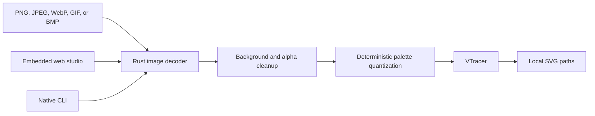

# img2svg Architecture and Operations

## Architecture



One Rust binary owns decoding, tracing, the CLI, and the embedded browser interface. Inputs never leave the host.

## Build and run

```bash
cd ~/multimedia/img2svg
./setupwithrust
./startwithrust
```

The setup performs a native release build with Cargo. The browser listens on port `417` unless `IMG2SVG_HOST` or `IMG2SVG_PORT` overrides it.

## Runtime lanes

- Browser: `./startwithrust`
- One conversion:

  ```bash
  target/release/img2svg convert logo.png logo.svg --preset logo --colors 6
  ```

- Recursive conversion:

  ```bash
  target/release/img2svg convert rasters vectors \
    --recursive true --preset poster --colors 12
  ```

Web uploads are bounded before decoding. Output is plain SVG path markup with no scripts or remote assets.

## Output serialization

Select **Serialized text** in the studio's Output menu. Its long-edge slider
runs from **32 to 1024**, independently of the SVG controls. ASCII strokes and
shades, shaded blocks, and Braille are available. The Text tab is selectable;
**Copy text**, **Copy data URI**, and **Download TXT** preserve every space and
newline. SVG remains the default and its tracing settings are unchanged.

This is the same programmatic raster/stroke/shade approach as Firebending
Cereal, implemented natively in Rust. There is no model inference, OCR, tracing,
background removal, trimming, autocontrast, or content-aware adjustment in this
lane. Premultiplied coverage and luminance are Lanczos-resampled over the entire
source canvas; fully transparent cells stay blank, while visible light pixels
remain distinguishable from transparency. The fixed 6×12 glyph atlas is embedded
at compile time (see `assets/README.md`); no installed fonts or Python runtime
are required. A sliding-row resampler avoids allocating a full 6× supersampled
floating-point image at 1024p. Glyph matching uses local coverage, directional
derivatives, and density with deterministic first-match tie breaking.

Terminal cells are treated as twice as tall as wide: a square source at 1024
becomes **1024 columns × 512 rows**, not 1024² characters. Source aspect ratio
and every canvas row/column are retained; dimensions floor to at least one cell.
EXIF orientation is applied before the mapping. PNG/JPEG/WebP/GIF/BMP use the
existing decoder support (animated sources serialize the decoded still frame).
Serialization accepts at most 64 megapixels, 32768 per source edge, and the
existing 64 MiB upload limit. Only one serialization job runs at a time; another
caller receives HTTP 429 without queuing large images.

The additive multipart endpoint is `POST /api/serialize`, with `image` and JSON
`options` fields. The JSON result contains the exact plain `text` plus
`cereal/1` geometry metadata. For example:

```sh
curl -sS http://127.0.0.1:417/api/serialize \
  -F image=@image.png \
  -F 'options={"resolution":256,"style":"ascii"}' \
  | jq -j .text > image.txt
```

The native `convert` CLI and `/api/vectorize` remain SVG-only. Nothing is saved
or buffered between serialization requests other than the immutable glyph atlas.
